# BookFlow MVP — Demonstrable Implementation Phase Plan (v1.0)

**Document Status:** Approved Implementation Phase Baseline
**Date:** 2026-10-12
**Governing Backlog:** `docs/project-management/backlog/backlog_manifest.json` (56 Tickets, `T-01` to `T-56`)
**Governing Requirements:** Approved BookFlow MVTS v1.1 (`docs/specifications/BookFlow_MVTS_v1.1.docx`)
**Frozen Design Foundation:** `ui-ux/design-system/AUTHORITATIVE_FOUNDATION_v1.1.md`
**Live Operational Board:** [BookFlow — MVP Implementation (Trello Board 3BOlXBHK)](https://trello.com/b/3BOlXBHK/bookflow-mvp-implementation)

---

## 1. Purpose, Strategy & Demonstration Fidelity

This document establishes the official demonstrable implementation phase breakdown for the BookFlow MVP backlog (`T-01` through `T-56`). The objective is to construct BookFlow incrementally so that after each phase, the team delivers a meaningful, testable, and demonstrable milestone to evaluators and stakeholders.

### Presentation-First Priority (Phase 1)
- **Immediate Presentation Milestone:** Phase 1 delivers the Public Marketing Landing Page (`PUB-01`) at the application root (`/`).
- **Pure Presentation Scope:** `PUB-01` has zero backend dependencies. Isolating Phase 1 to frontend initialization (`T-06`), shared core UI components (`T-07`), and the landing page screen (`T-26`) ensures a live, responsive, pixel-perfect demonstration can be presented immediately.
- **Clean Separation:** Backend solution scaffolding, SQL Server migrations, security middleware, and authentication APIs form the foundational prerequisite block for **Phase 2 (Authentication)**.

### Natural Operational User Journey
The implementation sequence follows the real product lifecycle:
1. **Visitor:** Arrives at the Public Landing Page (`PUB-01`) and clicks "Get Started".
2. **Owner Registration & Sign-In:** Registers business account (`AUTH-01`), signs in (`AUTH-02`), establishes secure session.
3. **Owner Portal Shell & Setup:** Enters `/portal`, views the portal shell and initial dashboard welcome/setup guidance, configures Business Profile (`OWN-06..08`), and manages account security (`OWN-09`).
4. **Service & Schedule Configuration:** Creates services (`OWN-03`), configures working hours and blocked dates (`OWN-04`).
5. **Customer Booking Journey:** Customer visits `/b/[slug]`, books an appointment through the 5-step flow (`CUS-01..05`).
6. **Owner Operations & Living Dashboard:** Owner returns to `/portal`, views a live Executive Dashboard (`OWN-01`) populated with real metrics and Today's Agenda, manages appointments (`OWN-02`), and manages CRM records (`OWN-05`).
7. **Platform Administration:** Platform Administrator logs in, monitors aggregate metrics (`ADM-01/04`), inspects businesses, and controls account activation (`ADM-02/03/05`).
8. **Release Acceptance:** Executes automated concurrency, security, accessibility, responsive, and performance benchmark suites.

### Demonstration Fidelity Standard
Throughout all phases, BookFlow strictly distinguishes between three engineering states:
1. **Visually Demonstrable Interface:** The interface renders with approved design tokens, typography (Inter), responsive behavior, and accessibility landmarks.
2. **Functional Feature:** Backed by real application logic, database transactions, and API contracts. No fake authentication, no mocked security, and no simulated business logic.
3. **Fully Tested & Accepted Feature:** Automated unit/integration tests and verification gates pass with empirical evidence.

---

## 2. High-Level Phase Overview & Ticket Accounting

Every single ticket (`T-01` to `T-56`) is accounted for exactly once. Zero tickets are omitted, duplicated, or rescaled.

| Phase ID | Phase Name | Ticket Count | Exact Ticket IDs | Primary Demonstrable Outcome |
| :--- | :--- | :---: | :--- | :--- |
| **PH-01** | **Public Landing Page** | 3 | `T-06, T-07, T-26` | A visitor navigates to `http://localhost:3000/`, views the landing page with approved typography (Inter), brand tokens (Primary Indigo `#2563EB`, Teal `#0D9488`), hero section, value propositions, and interactive buttons linking to `/register` and `/login`. Fully responsive across mobile (375px), tablet (768px), and desktop (1280px). |
| **PH-02** | **Authentication & Core Security Foundations** | 14 | `T-01, T-02, T-04, T-03, T-05, T-08, T-09, T-12, T-14, T-13, T-10, T-11, T-15, T-16` | A user registers a new account and business on `/register` (AUTH-01), database transaction creates `ApplicationUser` and `Business` atomically, user signs in on `/login` (AUTH-02), receives an HttpOnly SameSite=Lax session cookie via the Next.js proxy, validates CSRF token bootstrapping, and is redirected to `/portal`. Starting multiple API instances seeds exactly 1 Admin account without deadlocks. |
| **PH-03** | **Owner Portal Shell, Initial Dashboard & Business Profile** | 3 | `T-17, T-19, T-18` | Authenticated owner signs in -> lands on `/portal` -> views the authenticated portal layout, sidebar navigation, and initial dashboard shell (OWN-01 layout with zero-data onboarding guidance and setup shortcuts) -> edits business profile (OWN-06, OWN-07), copies their public booking URL (OWN-08), navigates to `/portal/account` (OWN-09), updates password, and logs out. |
| **PH-04** | **Services and Availability Configuration** | 6 | `T-20, T-22, T-23, T-21, T-24, T-25` | Owner adds services with durations and prices, soft-deactivates an obsolete service (OWN-03), defines weekly working hours with lunch split-shifts, and blocks unavailable dates (OWN-04). Concurrency conflicts on schedule replacement return HTTP 412 without orphaned records. |
| **PH-05** | **Public Guest Booking Journey** | 8 | `T-27, T-28, T-30, T-29, T-32, T-31, T-33, T-34` | Customer visits `/b/[slug]`, selects an active service (CUS-01), selects an available date and time slot (CUS-02), enters Full Name and Phone (CUS-03), reviews summary (CUS-04), submits without an account, and receives read-only confirmation with ReferenceCode (CUS-05). Serializable transactions prevent double-booking. |
| **PH-06** | **Owner Operations, CRM & Complete Executive Dashboard** | 12 | `T-35, T-37, T-41, T-43, T-45, T-36, T-38, T-39, T-42, T-44, T-46, T-40` | Owner opens `/portal`, views the Executive Dashboard with live KPI cards matching real database records (Today's, Upcoming, Customers, Completed) and Today's Agenda (OWN-01). Manages appointments (OWN-02), updates status via details drawer (T-38), reschedules via modal (T-40), searches CRM directory (OWN-05), and maintains internal notes (T-44). |
| **PH-07** | **Platform Administration & Multi-Business Governance** | 7 | `T-47, T-49, T-51, T-52, T-48, T-50, T-53` | Administrator signs in, views platform-wide metrics (total businesses, services, appointments, customers), searches businesses, inspects a business profile (ADM-03), and toggles activation to Inactive. Deactivation immediately blocks public booking (404) and owner mutations (403). |
| **PH-08** | **System-Wide Integration, Verification & Release Acceptance** | 3 | `T-54, T-55, T-56` | Automated CI test suites execute against SQL Server and pass with 100% success rate: 10 concurrent requests for same slot produce 1 success and 9 conflicts (T-54); cross-tenant access returns 404 (T-55); Playwright tests complete all 8 user journeys; Axe-core reports zero WCAG AA violations; and benchmark proves p95 response time < 2.0s under 20 concurrent VUs (T-56). Production release build exits with 0 warnings. |
| **Total** | **All 8 Phases** | **56** | **All 56 tickets accounted for** | **Complete, verifiable, demonstrable BookFlow MVP** |

---

## 3. Cross-Phase Dependency Graph

```mermaid
graph TD
    subgraph Phase1["Phase 1: Public Landing Page"]
        T06["T-06 Next.js & Tokens"] --> T07["T-07 Shared UI & Layouts"]
        T07 --> T26["T-26 Landing Page PUB-01"]
    end

    subgraph Phase2["Phase 2: Authentication & Security Foundations"]
        T01["T-01 Clean Architecture"] --> T02["T-02 Domain Entities"]
        T02 --> T03["T-03 Constraints & Migration"]
        T01 --> T04["T-04 Pipeline & Logging"]
        T04 --> T05["T-05 Rate Limiting"]
        T03 & T04 & T05 --> T08["T-08 Register API"]
        T08 --> T09["T-09 Login API"]
        T09 --> T12["T-12 BFF Proxy"]
        T12 --> T13["T-13 CSRF & Client"]
        T03 & T09 --> T14["T-14 Admin Seeding"]
        T09 & T13 --> T15["T-15 Tenant Scoping"]
        T15 --> T16["T-16 Activation Check"]
        T08 & T13 --> T10["T-10 Register UI AUTH-01"]
        T09 & T13 --> T11["T-11 Sign-In UI AUTH-02"]
    end

    subgraph Phase3["Phase 3: Owner Portal Shell & Business Profile"]
        T15 & T16 --> T17["T-17 Profile API"]
        T17 & T13 --> T18["T-18 Profile UI OWN-06..08"]
        T09 & T13 --> T19["T-19 Account Security OWN-09"]
    end

    subgraph Phase4["Phase 4: Services & Availability"]
        T15 & T16 --> T20["T-20 Services API"]
        T20 --> T21["T-21 Services UI OWN-03"]
        T02 --> T22["T-22 Working Periods"]
        T02 --> T23["T-23 Blocked Periods"]
        T15 & T16 & T22 & T23 --> T24["T-24 Availability API"]
        T24 --> T25["T-25 Working Hours UI OWN-04"]
    end

    subgraph Phase5["Phase 5: Public Guest Booking Journey"]
        T03 & T16 --> T27["T-27 Public Profile API"]
        T03 & T20 & T24 --> T28["T-28 Slot Engine"]
        T27 & T28 --> T29["T-29 Service/Date UI CUS-01/02"]
        T02 & T03 --> T30["T-30 Phone Normalization"]
        T29 --> T31["T-31 Intake Form CUS-03"]
        T03 & T05 & T13 & T28 & T30 --> T32["T-32 Booking API"]
        T31 & T32 --> T33["T-33 Review UI CUS-04"]
        T33 --> T34["T-34 Confirmation CUS-05"]
    end

    subgraph Phase6["Phase 6: Appointments, CRM & Dashboard"]
        T03 & T15 & T16 --> T35["T-35 Appointments Query API"]
        T35 --> T36["T-36 Agenda UI OWN-02"]
        T03 & T15 & T16 --> T37["T-37 Status State Machine API"]
        T37 --> T38["T-38 Status Drawer"]
        T28 & T37 --> T39["T-39 Reschedule API"]
        T39 --> T40["T-40 Reschedule Modal"]
        T03 & T15 & T16 --> T41["T-41 CRM Query API"]
        T41 --> T42["T-42 CRM Directory OWN-05"]
        T30 & T41 --> T43["T-43 Customer Dossier API"]
        T43 --> T44["T-44 Dossier & Notes UI"]
        T03 & T15 & T16 --> T45["T-45 Metrics API"]
        T36 & T45 --> T46["T-46 Dashboard OWN-01"]
    end

    subgraph Phase7["Phase 7: Platform Administration"]
        T03 & T09 & T14 --> T47["T-47 Platform Metrics API"]
        T47 --> T48["T-48 Admin Dashboard ADM-01/04"]
        T03 & T09 & T14 --> T49["T-49 Admin Businesses API"]
        T49 --> T50["T-50 Admin Businesses UI ADM-02"]
        T09 & T13 --> T51["T-51 Admin Account UI ADM-05"]
        T16 --> T52["T-52 Activation API"]
        T52 --> T53["T-53 Activation UI ADM-03"]
    end

    subgraph Phase8["Phase 8: Integration & Verification"]
        T24 & T32 & T37 & T39 --> T54["T-54 Concurrency Suite"]
        T05 & T12 & T13 & T14 & T15 & T16 --> T55["T-55 Security Suite"]
        Phase1 & Phase2 & Phase3 & Phase4 & Phase5 & Phase6 & Phase7 & T54 & T55 --> T56["T-56 Full Release Suite"]
    end

    Phase1 --> Phase2 --> Phase3 --> Phase4 --> Phase5 --> Phase6 --> Phase7 --> Phase8
```



---

## 4. Detailed Phase Specifications

### Phase 1 — Public Landing Page

- **Phase ID:** `PH-01`
- **Objective:** Establish the frontend Next.js application foundation and deliver a responsive marketing landing page (PUB-01) with frozen design system tokens and brand entry points.
- **Demonstrable Outcome:** A visitor navigates to `http://localhost:3000/`, views the landing page with approved typography (Inter), brand tokens (Primary Indigo `#2563EB`, Teal `#0D9488`), hero section, value propositions, and interactive buttons linking to `/register` and `/login`. Fully responsive across mobile (375px), tablet (768px), and desktop (1280px).

#### Exact Assigned Tickets (Dependency-Ordered Execution Sequence)

| Execution Step | Ticket ID | Title | Blocking Dependencies | Planning Prerequisites | Scope Summary | Key Acceptance Criteria |
| :---: | :--- | :--- | :--- | :--- | :--- | :--- |
| 1 | **`T-06`** | Scaffold Next.js App Router Project with Frozen Design System Tokens | *None (Root)* | *None* | Next.js App Router initialization with TypeScript; Tailwind CSS configuration embedding all frozen tokens from AUTHOR... | - `npm run build` succeeds cleanly in frontend directory.<br>  - Tailwind tokens match the exact hex codes in ui-ux/design-system/AUTHORITATIVE_FOUNDATION_v1.1.md. |
| 2 | **`T-07`** | Implement Shared UI Components and Presentation Route Groups | `T-06` | *None* | Core components: Button (Primary, Secondary, Destructive), InputField, TimeChip, StatusBadge (with text and distinct ... | - All components support loading, disabled, and error states.<br>  - Three distinct layout shells render cleanly across mobile (<640px), tablet (640-1024px), and desktop (1024px+). |
| 3 | **`T-26`** | Build Public Marketing Landing Page & Brand Entry Points (PUB-01) | `T-06`, `T-07` | *None* | Implementation of screen PUB-01 (Landing Page); brand hero section, product value proposition, feature highlights, "H... | - Page renders cleanly across mobile, tablet, and desktop viewports.<br>  - CTA buttons route cleanly to `/register` and `/login`.<br>  - Zero authenticated navigation items appear on the public landing page. |

#### Mandatory Prerequisites & Technical Rationale
T-06 is the root frontend ticket initializing Next.js, TypeScript, Tailwind tokens, and QueryClient. T-07 builds core reusable components and layout route shells. Neither requires backend APIs.

#### Scope Boundaries & Why Remaining Work is Excluded
Backend scaffolding (T-01..T-05) is deferred to Phase 2 to achieve the presentation-first priority immediately. PUB-01 has zero backend dependencies.

#### Concrete Acceptance & Verification Checks
- `npm run build` and `npm run lint` pass cleanly with exit code 0.
- Visual inspection confirms exact match with `exports/public-landing-page-desktop.png`.
- Responsive testing confirms zero horizontal scrollbar at 375px viewport width.
- Clicking 'Get Started' routes to `/register`; clicking 'Sign In' routes to `/login`.

---

### Phase 2 — Authentication & Core Security Foundations

- **Phase ID:** `PH-02`
- **Objective:** Establish the backend Clean Architecture solution, EF Core relational schema, security pipeline, Next.js BFF proxy, and deliver end-to-end business-owner registration, sign-in, and administrator startup seeding.
- **Demonstrable Outcome:** A user registers a new account and business on `/register` (AUTH-01), database transaction creates `ApplicationUser` and `Business` atomically, user signs in on `/login` (AUTH-02), receives an HttpOnly SameSite=Lax session cookie via the Next.js proxy, validates CSRF token bootstrapping, and is redirected to `/portal`. Starting multiple API instances seeds exactly 1 Admin account without deadlocks.

#### Exact Assigned Tickets (Dependency-Ordered Execution Sequence)

| Execution Step | Ticket ID | Title | Blocking Dependencies | Planning Prerequisites | Scope Summary | Key Acceptance Criteria |
| :---: | :--- | :--- | :--- | :--- | :--- | :--- |
| 1 | **`T-01`** | Initialize ASP.NET Core 8 Clean Architecture Solution & Projects | *None (Root)* | *None* | Creation of BookFlow.sln and four projects (BookFlow.Domain, BookFlow.Application, BookFlow.Infrastructure, BookFlow.... | - Solution builds cleanly with 0 errors and 0 warnings via `dotnet build BookFlow.sln`.<br>  - Architecture dependency rules strictly verified: Domain references no external project; Application references only Domain. |
| 2 | **`T-02`** | Define Domain Entities and EF Core Fluent API Configurations | `T-01` | *None* | Entities: ApplicationUser, Business, Service, Customer, Appointment, WorkingPeriod, UnavailablePeriod. Implement EF C... | - All 7 entities implemented with strictly typed properties matching the data model.<br>  - EF Core ModelBuilder configurations compile without errors. |
| 3 | **`T-04`** | Configure ASP.NET Core Middleware, Global RFC 7807 Exception Filter & Safe Logging | `T-01` | *None* | Global exception handler middleware returning RFC 7807 Problem Details with camelCase error keys; redaction of SQL ex... | - Unhandled exceptions return generic 500 Problem Details without leaking database details or stack traces.<br>  - Validation failures return 400 Bad Request with camelCase field keys. |
| 4 | **`T-03`** | Configure Composite Foreign Keys, Tenant Constraints & Generate Migration | `T-02` | `D-03` | Configure composite unique constraints: Service (Id, BusinessId), Customer (Id, BusinessId). Configure composite fore... | - Migration script explicitly contains composite foreign keys referencing (Id, BusinessId).<br>  - Migration script specifies ON DELETE RESTRICT (NO ACTION) for Appointment foreign keys.<br>  - Generated C# migration compiles cleanly. |
| 5 | **`T-05`** | Configure ASP.NET Core In-Memory Rate Limiting & 1MB Request Bounds | `T-04` | *None* | Memory-based ASP.NET Core RateLimiter policies for Login (5 req/min/IP), Registration (5 req/hr/IP), and Booking Crea... | - Automated requests exceeding configured rate limits return HTTP 429.<br>  - JSON payloads greater than 1 MB return HTTP 413. |
| 6 | **`T-08`** | Implement ASP.NET Core Identity Model & Business Owner Registration API | `T-03`, `T-04`, `T-05` | `D-03` | `ApplicationUser : IdentityUser` configuration; `POST /api/v1/auth/register` endpoint; validation of Email (max 256),... | - Successful registration creates both ApplicationUser and Business atomically.<br>  - Failed business creation completely rolls back user creation (no orphaned users).<br>  - Attempting to register with an existing email returns HTTP 400 Problem Details. |
| 7 | **`T-09`** | Implement Shared Login, Cookie Session Management & Password Change API | `T-08` | `D-01`, `D-02` | `POST /api/v1/auth/login` for Owners and Admins; issuance of HttpOnly, Secure, SameSite=Lax authentication cookie; `P... | - Valid login sets `Set-Cookie` with HttpOnly and SameSite=Lax attributes.<br>  - `GET /api/v1/auth/me` returns role "Owner" with businessId for owners, and role "Admin" with null businessId for admins.<br>  - Logout clears authentication cookie. |
| 8 | **`T-12`** | Configure Next.js API Proxy Rewrites & Multiple Set-Cookie Proof of Concept | `T-07`, `T-09` | `D-01` | Next.js `next.config.js` rewrites configuration proxying `/api/*` to the backend ASP.NET Core URL; implementation of ... | - Automated integration test proves that when backend sends multiple `Set-Cookie` headers, the browser receives each independent cookie with correct attributes. |
| 9 | **`T-14`** | Implement Concurrent-Safe Administrator Startup Provisioning & Seed Logic | `T-03`, `T-09` | *None* | C# startup initialization block in Infrastructure; creation of `Owner` and `Admin` roles; reading initial Admin crede... | - First startup provisions exact Admin user in `Admin` role.<br>  - Starting 5 simultaneous instances against an empty database results in exactly one Admin account without deadlock.<br>  - Subsequent restarts skip seeding without resetting passwords. |
| 10 | **`T-13`** | Implement Global CSRF Antiforgery Validation, Bootstrap API & Centralized Client Interceptor | `T-12` | *None* | Backend: `GET /api/v1/auth/csrf` public bootstrap endpoint issuing HttpOnly cookie and JS-readable `XSRF-TOKEN` cooki... | - Centralized client automatically attaches `X-XSRF-TOKEN` to all mutating requests without manual form intervention.<br>  - Unsafe request without `X-XSRF-TOKEN` header is rejected with 400 Bad Request.<br>  - Request with mismatched Origin header is rejected with 403 Forbidden. |
| 11 | **`T-10`** | Build Business Owner Registration Screen UI (AUTH-01) | `T-07`, `T-08`, `T-13` | *None* | Implementation of screen AUTH-01 at `/register`; inputs for Email, Password, and Business Name; client-side Zod valid... | - Form displays inline validation errors for missing fields or strings exceeding maximum bounds.<br>  - Submitting form enters loading state and disables submit button.<br>  - Duplicate email error from backend displays clear RFC 7807 error banner.<br>  - Clean responsive rendering across desktop, tablet, and mobile. |
| 12 | **`T-11`** | Build Sign-In Screen UI (AUTH-02) & Role-Based Navigation Routing | `T-07`, `T-09`, `T-13` | *None* | Implementation of screen AUTH-02 at `/login`; inputs for Email and Password; client-side validation; TanStack Query m... | - Invalid credentials display clear "Invalid email or password" error banner.<br>  - Successful owner login redirects to `/portal`.<br>  - Successful admin login redirects to `/admin`.<br>  - Rate limit exceeded (429) displays clear retry alert. |
| 13 | **`T-15`** | Implement Tenant Isolation Filter & Claims Scoping Infrastructure | `T-09`, `T-13` | *None* | Custom action filter / base controller extracting `BusinessId` and `OwnerId` strictly from `ClaimsPrincipal`; automat... | - An owner cannot access or mutate another business's data; attempt returns HTTP 404.<br>  - Zero endpoints accept `businessId` as a client-supplied query parameter or body property. |
| 14 | **`T-16`** | Implement Authoritative Database Business Activation Evaluation Middleware | `T-15` | *None* | Dynamic database query checking `Business.IsActive` directly from SQL Server on every mutating request (POST, PUT, DE... | - Mutating request on deactivated business returns HTTP 403 Forbidden.<br>  - Logout and change-password remain functional for owners of deactivated businesses. |

#### Mandatory Prerequisites & Technical Rationale
T-01 through T-05 establish the database context, schema migrations, and security middleware. T-12 and T-13 establish proxy cookie forwarding and CSRF protection before auth UI mutations.

#### Scope Boundaries & Why Remaining Work is Excluded
Owner portal profile editing and operational settings are deferred to Phase 3. Real appointment operations remain outside Phase 2.

#### Concrete Acceptance & Verification Checks
- `dotnet build BookFlow.sln` compiles with 0 warnings.
- Submitting `/register` with duplicate email returns RFC 7807 problem details (HTTP 400).
- Submitting valid credentials on `/login` sets HttpOnly cookie and navigates to `/portal`.
- Gate K-2 passed: Next.js forwards multiple `Set-Cookie` headers intact.
- Gate K-7 passed: Startup seeding safely seeds 1 Admin account without deadlocks.

---

### Phase 3 — Owner Portal Shell, Initial Dashboard & Business Profile

- **Phase ID:** `PH-03`
- **Objective:** Deliver the authenticated owner application shell, navigation system, initial dashboard landing shell (OWN-01 layout shell, onboarding/setup guidance, quick actions), Business Profile management (OWN-06, OWN-07, OWN-08), and account security settings (OWN-09).
- **Demonstrable Outcome:** Authenticated owner signs in -> lands on `/portal` -> views the authenticated portal layout, sidebar navigation, and initial dashboard shell (OWN-01 layout with zero-data onboarding guidance and setup shortcuts) -> edits business profile (OWN-06, OWN-07), copies their public booking URL (OWN-08), navigates to `/portal/account` (OWN-09), updates password, and logs out.

#### Exact Assigned Tickets (Dependency-Ordered Execution Sequence)

| Execution Step | Ticket ID | Title | Blocking Dependencies | Planning Prerequisites | Scope Summary | Key Acceptance Criteria |
| :---: | :--- | :--- | :--- | :--- | :--- | :--- |
| 1 | **`T-17`** | Implement Business Profile Management API Endpoints | `T-15`, `T-16` | `D-03` | `GET /api/v1/business-profile` and `PUT /api/v1/business-profile`; support for Name, Slug, TimeZoneId (validated IANA... | - Invalid IANA timezone returns 400 Bad Request.<br>  - Duplicate slug returns 409 Conflict.<br>  - Valid payload updates business profile and returns 200 OK. |
| 2 | **`T-19`** | Build Owner Account & Security Screen UI (OWN-09) | `T-07`, `T-09`, `T-13` | *None* | Implementation of screen OWN-09 at `app/(owner)/portal/account/`; display authenticated owner email (read-only); pass... | - Form validates that New Password matches Confirm New Password.<br>  - Submitting invalid current password displays error banner returned from API.<br>  - Successful password change displays success notification and clears form inputs.<br>  - Clicking Logout terminates session and redirects to `/login`. |
| 3 | **`T-18`** | Build Owner Business Profile Overview, Editing & Public Link UI (OWN-06, OWN-07, OWN-08) | `T-07`, `T-13`, `T-17` | *None* | Implementation of screens OWN-06 (Overview), OWN-07 (Edit Form), and OWN-08 (Public Link / Settings) in `app/(owner)/... | - Form validates required fields and character limits before submission.<br>  - Submitting valid form displays success toast and updates cached profile.<br>  - Copy link action copies formatted URL `https://domain/b/[slug]`. |

#### Mandatory Prerequisites & Technical Rationale
T-15 and T-16 enforce tenant isolation and active status on profile mutations. T-13 provides CSRF interceptors for form submissions.

#### Scope Boundaries & Why Remaining Work is Excluded
Real appointment directory and live operational metrics (T-45, T-46) are deferred to Phase 6. Real bookings must be created in Phase 5 first to avoid demonstrating an artificial, empty KPI dashboard.

#### Concrete Acceptance & Verification Checks
- Updating Business Profile with invalid IANA timezone returns HTTP 400.
- Updating Slug collision returns HTTP 409 Conflict.
- Copying booking link copies valid URL `https://<domain>/b/[slug]`.
- Password change refreshes security stamp; secondary session invalidated within 5 minutes (Decision D-02).

---

### Phase 4 — Services and Availability Configuration

- **Phase ID:** `PH-04`
- **Objective:** Implement service catalog management (OWN-03) and recurring split-shift availability / blocked dates (OWN-04) with optimistic concurrency control.
- **Demonstrable Outcome:** Owner adds services with durations and prices, soft-deactivates an obsolete service (OWN-03), defines weekly working hours with lunch split-shifts, and blocks unavailable dates (OWN-04). Concurrency conflicts on schedule replacement return HTTP 412 without orphaned records.

#### Exact Assigned Tickets (Dependency-Ordered Execution Sequence)

| Execution Step | Ticket ID | Title | Blocking Dependencies | Planning Prerequisites | Scope Summary | Key Acceptance Criteria |
| :---: | :--- | :--- | :--- | :--- | :--- | :--- |
| 1 | **`T-20`** | Implement Service Catalog CRUD & Soft-Deactivation API | `T-15`, `T-16` | *None* | `GET /api/v1/services` (returns all active and inactive), `POST /api/v1/services`, `PUT /api/v1/services/{id}`; valid... | - Duration < 5 or > 1440 returns 400 Bad Request.<br>  - Price < 0 returns 400 Bad Request.<br>  - Deactivating a service marks `IsActive = false` while preserving existing entity and DB records. |
| 2 | **`T-22`** | Implement Working Period Domain Rules & Split-Shift Validation | `T-02` | *None* | Domain validation for `WorkingPeriod`: DayOfWeek (0–6), local StartTime, local EndTime; support split shifts (multipl... | - Shift with StartTime >= EndTime is rejected.<br>  - Overlapping shifts on the same DayOfWeek are rejected with 400 Bad Request. |
| 3 | **`T-23`** | Implement Unavailable Period Domain Rules & Temporal Bounds Validation | `T-02` | *None* | Domain validation for `UnavailablePeriod`: StartDateTime (UTC), EndDateTime (UTC), optional Reason (max 500 chars); e... | - Block with StartDateTime >= EndDateTime is rejected.<br>  - Non-UTC datetime inputs are rejected or parsed strictly as UTC. |
| 4 | **`T-21`** | Build Owner Services Catalog Interface & CRUD Modal (OWN-03) | `T-07`, `T-20` | *None* | Implementation of screen OWN-03 (Services); service cards/table layout; Create Service modal; Edit Service modal; Act... | - Displays list of active and inactive services with status badges.<br>  - Owner can toggle service active status with immediate UI feedback.<br>  - Form displays inline validation errors for negative price or duration out of range. |
| 5 | **`T-24`** | Implement Availability Aggregate API with Parent Business RowVersion Concurrency | `T-15`, `T-16`, `T-22`, `T-23` | *None* | `GET /api/v1/availability` returning workingPeriods, unavailablePeriods, and strong ETag from `Business.RowVersion`; ... | - `GET /api/v1/availability` returns `ETag: "0x..."`.<br>  - `PUT` with valid `If-Match` atomically updates periods and increments Business.RowVersion.<br>  - `PUT` with stale `If-Match` returns HTTP 412 and leaves existing periods completely unchanged. |
| 6 | **`T-25`** | Build Owner Working Hours & Blocked Periods Interface (OWN-04) | `T-07`, `T-24` | *None* | Implementation of screen OWN-04 (Availability); weekly 7-day schedule grid with day toggles; add/remove split shifts ... | - User can configure split shifts (e.g., 09:00-12:00 and 13:00-17:00) on any active day.<br>  - User can add a blocked period with reason.<br>  - Saving sends full aggregate payload with ETag; on 412 conflict, displays clear reload alert. |

#### Mandatory Prerequisites & Technical Rationale
T-22 and T-23 define domain rules and UTC conversion for working periods and blocked times. T-20 provides service catalog endpoints. T-24 provides concurrency-protected availability replacement.

#### Scope Boundaries & Why Remaining Work is Excluded
Public time-slot calculation (T-28) and public booking UI (T-29) belong to Phase 5.

#### Concrete Acceptance & Verification Checks
- Service duration < 5 mins or > 1440 mins returns HTTP 400 Problem Details.
- Overlapping working periods within the same day are rejected with HTTP 400.
- Saving availability triggers atomic replacement guarded by `Business.RowVersion` (Gate K-9).
- Deactivating a service sets `IsActive = false` without deleting existing records.

---

### Phase 5 — Public Guest Booking Journey

- **Phase ID:** `PH-05`
- **Objective:** Deliver the complete, accountless 5-step customer booking flow at `/b/[slug]`, backed by dynamic bookable slot calculation and serializable concurrency protection.
- **Demonstrable Outcome:** Customer visits `/b/[slug]`, selects an active service (CUS-01), selects an available date and time slot (CUS-02), enters Full Name and Phone (CUS-03), reviews summary (CUS-04), submits without an account, and receives read-only confirmation with ReferenceCode (CUS-05). Serializable transactions prevent double-booking.

#### Exact Assigned Tickets (Dependency-Ordered Execution Sequence)

| Execution Step | Ticket ID | Title | Blocking Dependencies | Planning Prerequisites | Scope Summary | Key Acceptance Criteria |
| :---: | :--- | :--- | :--- | :--- | :--- | :--- |
| 1 | **`T-27`** | Implement Public Business Profile & Active Services Endpoints | `T-03`, `T-16` | *None* | `GET /api/v1/public/b/{slug}` returning name, slug, timeZoneId, currencyCode, currencySymbol, bio, logoUrl; `GET /api... | - Public profile excludes OwnerId and concurrency tokens.<br>  - Inactive services are omitted from the public services response.<br>  - Request to a deactivated business returns HTTP 404 Not Found. |
| 2 | **`T-28`** | Implement Dynamic Time-Slot Availability Generation Engine | `T-03`, `T-20`, `T-24` | *None* | `GET /api/v1/public/b/{slug}/services/{serviceId}/availability` with `startDate` and `endDate`; date range limit max ... | - Querying an unknown business slug returns HTTP 404 Not Found.<br>  - Querying a deactivated business returns HTTP 404 Not Found.<br>  - Querying an invalid service ID for the business returns HTTP 404 Not Found.<br>  - Querying an inactive service (`IsActive = false`) returns HTTP 400 Bad Request.<br>  - Valid queries return 200 OK with accurate slot bounds respecting working shifts and DST. |
| 3 | **`T-30`** | Implement Phone Normalization Service & CRM Matching Rules | `T-02`, `T-03` | *None* | Domain service normalizing valid phone numbers to strict E.164 (`IsPhoneValid = true`); fallback stripping non-alphan... | - Valid international number normalized to E.164.<br>  - Subsequent booking with same phone number links to original Customer.Id.<br>  - Different business with identical phone creates separate Customer record (tenant isolation). |
| 4 | **`T-29`** | Build Public Service Selection & Date/Time Picker Screens (CUS-01, CUS-02) | `T-07`, `T-27`, `T-28` | *None* | Implementation of screens CUS-01 (Service Selection) and CUS-02 (Date & Time Picker) at `/b/[slug]`; interactive serv... | - User can select an active service and navigate to date/time picker.<br>  - Selecting a date fetches slots and displays chips with UTC times converted to business local time.<br>  - Unavailable dates show clear empty state. |
| 5 | **`T-32`** | Implement Serializable Booking Creation API & Deadlock Retry Strategy | `T-03`, `T-05`, `T-13`, `T-28`, `T-30` | *None* | `POST /api/v1/public/b/{slug}/bookings`; input: serviceId, startTimeUtc, customerName, customerPhone, customerEmail; ... | - Booking is created with snapshot values matching the service at time of booking.<br>  - Concurrent overlapping requests result in exactly one 201 Created and subsequent requests receiving 409 Conflict.<br>  - Deadlock 1205 is caught and retried automatically. |
| 6 | **`T-31`** | Build Public Customer Information Intake Screen (CUS-03) | `T-07`, `T-29` | *None* | Implementation of screen CUS-03 (Customer Details); form strictly limited to 3 fields: Full Name (required, max 100 c... | - Form blocks submission if Full Name or Phone Number is empty.<br>  - Submitting with valid fields proceeds to Step 4.<br>  - Zero out-of-scope fields exist on the form. |
| 7 | **`T-33`** | Build Public Booking Review & Summary Screen (CUS-04) | `T-07`, `T-31`, `T-32` | *None* | Implementation of screen CUS-04 (Public Booking — Review); appointment summary card displaying Service Name, Duration... | - Displays accurate summary of user choices.<br>  - Clicking "Edit" on service or date returns user to previous step preserving selections.<br>  - Successful submission transitions to Step 5 (Confirmation).<br>  - 409 Conflict displays clear error message and navigates user back to time selection. |
| 8 | **`T-34`** | Build Read-Only In-App Booking Confirmation Screen (CUS-05) | `T-07`, `T-33` | *None* | Implementation of screen CUS-05 (Public Booking — Request Received); prominent display of alphanumeric Booking Refere... | - Confirmation screen displays reference code and Pending status.<br>  - Zero self-service action buttons or external export buttons exist on the screen. |

#### Mandatory Prerequisites & Technical Rationale
T-20 (Services) and T-24 (Availability) are required by T-28 to compute available slots. T-30 provides E.164 phone normalization. T-32 provides serializable booking creation with deadlock retry.

#### Scope Boundaries & Why Remaining Work is Excluded
Owner appointment status changes and rescheduling actions belong to Phase 6.

#### Concrete Acceptance & Verification Checks
- Unknown slug or inactive business returns HTTP 404.
- Time slots accurately account for business working hours, existing bookings, and DST transitions (Gate K-11).
- Customer intake form requires Full Name and Phone; Email is optional (FR-16).
- 5-step sequential stepper progresses from 1 to 5 with Back editing support (Decision D-04).
- Confirmation page renders alphanumeric ReferenceCode with zero cancel/export actions (FR-19).

---

### Phase 6 — Owner Operations, CRM & Complete Executive Dashboard

- **Phase ID:** `PH-06`
- **Objective:** Deliver operational appointment management (OWN-02), lifecycle status transitions, rescheduling modal, customer CRM directory (OWN-05), customer historical dossier with private notes, and fully wire up the Executive Dashboard (OWN-01) with live operational metrics and Today's Agenda populated by real customer bookings from Phase 5.
- **Demonstrable Outcome:** Owner opens `/portal`, views the Executive Dashboard with live KPI cards matching real database records (Today's, Upcoming, Customers, Completed) and Today's Agenda (OWN-01). Manages appointments (OWN-02), updates status via details drawer (T-38), reschedules via modal (T-40), searches CRM directory (OWN-05), and maintains internal notes (T-44).

#### Exact Assigned Tickets (Dependency-Ordered Execution Sequence)

| Execution Step | Ticket ID | Title | Blocking Dependencies | Planning Prerequisites | Scope Summary | Key Acceptance Criteria |
| :---: | :--- | :--- | :--- | :--- | :--- | :--- |
| 1 | **`T-35`** | Implement Owner Appointment Directory Query API | `T-03`, `T-15`, `T-16` | *None* | `GET /api/v1/appointments`; query parameters: `startDate`, `endDate`, `status` (repeated), `page` (default 1), `pageS... | - Range > 366 days or pageSize > 100 returns 400 Bad Request.<br>  - Query defaults to business local calendar month when dates omitted.<br>  - Excludes Customer.Notes from response items. |
| 2 | **`T-37`** | Implement Appointment Details & Status Transition State Machine API | `T-03`, `T-15`, `T-16` | *None* | `GET /api/v1/appointments/{id}` returning full details and strong ETag from `Appointment.RowVersion`; `PUT /api/v1/ap... | - Transition from Completed to Confirmed returns 400 Bad Request.<br>  - Updating status with stale ETag returns 412 Precondition Failed.<br>  - Cross-tenant ID query returns 404 Not Found. |
| 3 | **`T-41`** | Implement Owner Customer CRM Directory Query API | `T-03`, `T-15`, `T-16` | *None* | `GET /api/v1/customers`; pagination parameters: `page` (default 1), `pageSize` (default 50, max 100); deterministic o... | - Returns paginated list of customers belonging exclusively to authenticated business.<br>  - Values < 1 or pageSize > 100 return 400 Bad Request.<br>  - Excludes Customer.Notes from list response. |
| 4 | **`T-43`** | Implement Customer Profile Details, Appointment History & Notes API | `T-03`, `T-15`, `T-16`, `T-30` | *None* | `GET /api/v1/customers/{id}` returning customer profile, private Notes, and complete appointment history (id, startTi... | - Response includes private Notes and appointment history.<br>  - Updating phone to an existing valid number belonging to another customer returns 409 Conflict.<br>  - Updating notes saves text and returns 200 OK. |
| 5 | **`T-45`** | Implement Owner Dashboard Operational Metrics API | `T-03`, `T-15`, `T-16` | `D-05` | `GET /api/v1/dashboard/metrics`; calculate: `todayAppointments` (appointments on current local calendar date in busin... | - `todayAppointments` strictly evaluates against the business's configured `TimeZoneId`.<br>  - Cancelled appointments are excluded from todayAppointments.<br>  - Queries execute efficiently using database COUNT queries. |
| 6 | **`T-36`** | Build Owner Appointments Agenda & Directory Interface (OWN-02) | `T-07`, `T-35` | *None* | Implementation of screen OWN-02 (Appointments); calendar/agenda view toggle; date range picker (defaulting to current... | - Displays appointments with distinct status badge colors and icons matching design system tokens.<br>  - Filter pills dynamically update query and refetch data.<br>  - Empty state renders cleanly when no appointments match filter.<br>  - Zero status mutation or rescheduling logic implemented in this component. |
| 7 | **`T-38`** | Build Owner Appointment Details Drawer & Status Transition Actions (Authoritative Status Owner) | `T-07`, `T-37` | *None* | Implementation of appointment detail inspection modal/drawer; display customer details, service snapshot, reference c... | - Permitted action buttons match current status (e.g., "Confirm" visible on Pending, hidden on Confirmed).<br>  - Cancelling prompts for confirmation before sending PUT request.<br>  - On 412 conflict, displays toast notification prompting reload. |
| 8 | **`T-39`** | Implement Owner Appointment Rescheduling Transaction API | `T-03`, `T-15`, `T-16`, `T-28`, `T-37` | *None* | `PUT /api/v1/appointments/{id}/reschedule`; requires `If-Match` with exact strong ETag; input: `{ startTimeUtc }`; st... | - Rescheduling preserves original customer ID and service price/duration snapshots.<br>  - Attempting to reschedule to an overlapping slot returns 409 Conflict.<br>  - Rescheduling a Completed or Cancelled appointment returns 400 Bad Request. |
| 9 | **`T-42`** | Build Owner CRM Customer Directory Interface (OWN-05) | `T-07`, `T-41` | *None* | Implementation of screen OWN-05 (Customers); table and card layouts with Customer Name, Phone, Email, and validity in... | - Displays customer records with formatted phone and email.<br>  - Shows warning icon/indicator if IsPhoneValid is false.<br>  - Pagination navigation cleanly refetches and updates table. |
| 10 | **`T-44`** | Build Owner Customer Dossier, Appointment History & Internal Notes UI | `T-07`, `T-43` | *None* | Customer detail drawer/page; display contact details, total visits count, and chronological appointment history timel... | - Private notes editor displays existing text and allows editing up to 2000 characters.<br>  - Appointment history timeline shows past appointments with service snapshots and statuses.<br>  - Collision error (409) displays clear banner alerting owner of duplicate number. |
| 11 | **`T-46`** | Build Owner Executive Dashboard Interface & Today's Agenda (OWN-01) | `T-07`, `T-36`, `T-45` | *None* | Implementation of screen OWN-01 (Dashboard); 4 KPI metric cards (Today's Appointments, Upcoming, Active Customers, Co... | - KPI cards display numbers matching backend response.<br>  - Agenda widget displays today's appointments in chronological order.<br>  - Quick action links route directly to respective portal sections. |
| 12 | **`T-40`** | Build Owner Reschedule Appointment Modal Interface | `T-07`, `T-39` | *None* | RescheduleModal component; date picker and available time slot picker (reusing availability calculation hook); slot s... | - Displays available slots for the selected date.<br>  - Submitting new slot sends PUT request and closes modal upon 200 OK.<br>  - If 409 Conflict occurs, displays error explaining the slot was taken. |

#### Mandatory Prerequisites & Technical Rationale
T-35, T-37, T-41, T-43, and T-45 provide backend APIs. Real appointments created during Phase 5 ensure the dashboard and agenda reflect genuine, living data.

#### Scope Boundaries & Why Remaining Work is Excluded
Administrator views and actions belong to Phase 7.

#### Concrete Acceptance & Verification Checks
- Status transitions strictly follow state machine: `Pending` -> `Confirmed` / `Cancelled` (FR-22).
- Stale ETag on status update or reschedule returns HTTP 412 Precondition Failed (Gate K-10).
- Customer notes (up to 2000 chars) persist and are omitted from all public APIs.
- Dashboard upcoming appointments counts all future Pending/Confirmed bookings indefinitely (Decision D-05).

---

### Phase 7 — Platform Administration & Multi-Business Governance

- **Phase ID:** `PH-07`
- **Objective:** Deliver platform administrator capabilities: dedicated layout shell, platform aggregate metrics (ADM-01, ADM-04), multi-business directory with search and filtering (ADM-02), account activation control (ADM-03), and admin account settings (ADM-05).
- **Demonstrable Outcome:** Administrator signs in, views platform-wide metrics (total businesses, services, appointments, customers), searches businesses, inspects a business profile (ADM-03), and toggles activation to Inactive. Deactivation immediately blocks public booking (404) and owner mutations (403).

#### Exact Assigned Tickets (Dependency-Ordered Execution Sequence)

| Execution Step | Ticket ID | Title | Blocking Dependencies | Planning Prerequisites | Scope Summary | Key Acceptance Criteria |
| :---: | :--- | :--- | :--- | :--- | :--- | :--- |
| 1 | **`T-47`** | Implement Platform Administrator Aggregate Metrics API | `T-03`, `T-09`, `T-14` | *None* | `GET /api/v1/admin/metrics`; requires `Admin` role; calculate: `totalRegisteredBusinesses` (total Business records), ... | - Requires Admin role; Owner role receives 403 Forbidden.<br>  - Accurately counts registered and active businesses across platform. |
| 2 | **`T-49`** | Implement Platform Administrator Business Directory Query API | `T-03`, `T-09`, `T-14` | *None* | `GET /api/v1/admin/businesses`; requires `Admin` role; query parameters: `searchTerm` (matches name or slug), `status... | - Requires Admin role; Owner role receives 403 Forbidden.<br>  - Filter by status `Inactive` returns only inactive businesses.<br>  - Search term filters by business name or slug substring. |
| 3 | **`T-51`** | Build Platform Administrator Account & Security Screen UI (ADM-05) | `T-07`, `T-09`, `T-13` | *None* | Implementation of screen ADM-05 at `app/(admin)/admin/account/`; display authenticated admin email and administrative... | - Displays authenticated administrator email.<br>  - Clicking Logout prompts for confirmation, invalidates session via API, and redirects to `/login`. |
| 4 | **`T-52`** | Implement Admin Business Details & Account Status Activation API | `T-03`, `T-09`, `T-13`, `T-14`, `T-16` | *None* | `GET /api/v1/admin/businesses/{id}` returning business profile, owner info (id, email), and usage metrics (totalCusto... | - Updating status to `isActive: false` updates database record and returns 200 OK.<br>  - Update with stale ETag returns 412 Precondition Failed.<br>  - Invalid ID returns 404 Not Found. |
| 5 | **`T-48`** | Build Platform Administrator Dashboard & Analytics UI (ADM-01, ADM-04) | `T-07`, `T-47` | *None* | Implementation of screens ADM-01 (Admin Dashboard) and ADM-04 (Platform Usage); 4 platform KPI cards (Total Registere... | - Admin KPIs render correctly from API response.<br>  - Protected by admin session check; unauthorized users redirected to login. |
| 6 | **`T-50`** | Build Platform Admin Shell & Registered Businesses Directory Interface (ADM-02) | `T-07`, `T-49` | *None* | Implementation of screen ADM-02 (Businesses Directory); dedicated administrative shell with distinct top bar/sidebar;... | - Directory displays registered businesses with status badges.<br>  - Search and filter controls trigger immediate refetch with debounced query.<br>  - Clicking a business navigates to its details view. |
| 7 | **`T-53`** | Build Admin Business Details Inspection & Activation Control Interface (ADM-03) | `T-07`, `T-52` | *None* | Implementation of screen ADM-03 (Business Details); display business profile, owner information, and usage metrics; "... | - Displays business profile and usage metrics (customers, appointments).<br>  - Toggling status opens confirmation modal; confirming sends PUT request with If-Match header.<br>  - Status badge updates immediately upon successful response. |

#### Mandatory Prerequisites & Technical Rationale
T-14 seeded initial admin credentials. T-16 provides database activation evaluation. T-47, T-49, T-52 provide administrative endpoints.

#### Scope Boundaries & Why Remaining Work is Excluded
Automated end-to-end integration and benchmarking test suites belong to Phase 8.

#### Concrete Acceptance & Verification Checks
- Non-admin sessions attempting to access `/api/v1/admin/*` receive HTTP 403 Forbidden (NFR-07).
- Sensitive customer private notes and PII are excluded from admin inspection payloads (NFR-08).
- Deactivating a business immediately returns HTTP 404 for public booking endpoints and HTTP 403 for owner mutations (Decision D-06).

---

### Phase 8 — System-Wide Integration, Verification & Release Acceptance

- **Phase ID:** `PH-08`
- **Objective:** Execute comprehensive automated test suites covering concurrency, security, accessibility, responsiveness, end-to-end user journeys, and latency benchmarks to achieve formal build acceptance.
- **Demonstrable Outcome:** Automated CI test suites execute against SQL Server and pass with 100% success rate: 10 concurrent requests for same slot produce 1 success and 9 conflicts (T-54); cross-tenant access returns 404 (T-55); Playwright tests complete all 8 user journeys; Axe-core reports zero WCAG AA violations; and benchmark proves p95 response time < 2.0s under 20 concurrent VUs (T-56). Production release build exits with 0 warnings.

#### Exact Assigned Tickets (Dependency-Ordered Execution Sequence)

| Execution Step | Ticket ID | Title | Blocking Dependencies | Planning Prerequisites | Scope Summary | Key Acceptance Criteria |
| :---: | :--- | :--- | :--- | :--- | :--- | :--- |
| 1 | **`T-54`** | Execute Automated SQL Server Concurrency, Deadlock & ETag Verification Suite | `T-24`, `T-32`, `T-37`, `T-39` | *None* | Automated integration tests executing against a real SQL Server instance (Docker or local instance) via `WebApplicati... | - All concurrency and deadlock integration tests execute and pass with 100% success rate against SQL Server. |
| 2 | **`T-55`** | Execute Automated Tenant Isolation, CSRF & Proxy Security Verification Suite | `T-05`, `T-12`, `T-13`, `T-14`, `T-15`, `T-16` | *None* | Automated security integration tests verifying:     1. Cross-Tenant Denial (Gate K-1): Owner A receives 404 Not Found... | - All security tests pass with 100% success rate.<br>  - Zero cross-tenant data leaks observed. |
| 3 | **`T-56`** | Execute End-to-End Journey Verification, Accessibility, Responsive & Performance Benchmark Suite | `T-01`, `T-02`, `T-03`, `T-04`, `T-05`, `T-06`, `T-07`, `T-08`, `T-09`, `T-10`, `T-11`, `T-12`, `T-13`, `T-14`, `T-15`, `T-16`, `T-17`, `T-18`, `T-19`, `T-20`, `T-21`, `T-22`, `T-23`, `T-24`, `T-25`, `T-26`, `T-27`, `T-28`, `T-29`, `T-30`, `T-31`, `T-32`, `T-33`, `T-34`, `T-35`, `T-36`, `T-37`, `T-38`, `T-39`, `T-40`, `T-41`, `T-42`, `T-43`, `T-44`, `T-45`, `T-46`, `T-47`, `T-48`, `T-49`, `T-50`, `T-51`, `T-52`, `T-53`, `T-54`, `T-55` | *None* | Inclusions:     1. Automated Browser E2E Tests: Playwright test suite executing all 8 User Flows across guest booking... | - All Playwright E2E user flow tests pass cleanly.<br>  - Axe-core accessibility scans pass with 0 critical/serious WCAG AA violations.<br>  - Latency benchmark demonstrates p95 response time < 2.0s under the 20-VU test condition.<br>  - Frontend and backend production release builds complete with Exit Code 0. |

#### Mandatory Prerequisites & Technical Rationale
Requires all product feature tickets (T-01 through T-53) to be fully implemented and merged in Done status.

#### Scope Boundaries & Why Remaining Work is Excluded
Production cloud deployment is out of scope for MVP per ADR-0001.

#### Concrete Acceptance & Verification Checks
- `dotnet test tests/BookFlow.IntegrationTests --filter Category=Concurrency` passes 100% (Gates K-8..K-11).
- `dotnet test tests/BookFlow.SecurityTests` passes 100% with zero tenant leaks (Gates K-1..K-7).
- `npx playwright test` completes all 8 flows across mobile, tablet, and desktop viewports.
- `npm run test:a11y` passes with 0 critical/serious WCAG AA violations.
- Benchmark run reports p95 < 2000ms under 20 concurrent simulated virtual users (Decision D-07).
- `dotnet build BookFlow.sln -c Release` and `npm run build` exit with code 0.

---

## 5. Cross-Phase Dependencies & Shared Assets Analysis

### Cross-Phase Prerequisite Matrix

| Dependent Phase | Relies On Phase(s) | Specific Prerequisite Tickets & Artifacts | Why It Is Mandatory |
| :--- | :--- | :--- | :--- |
| **Phase 2 (Auth)** | Phase 1 | `T-06`, `T-07` | Next.js layout shells and reusable UI components needed for `AUTH-01` (`T-10`) and `AUTH-02` (`T-11`). |
| **Phase 3 (Profile)** | Phase 1, Phase 2 | `T-07`, `T-09`, `T-13`, `T-15`, `T-16` | Owner authentication, CSRF client interceptor, and tenant claims scoping required to read/update business profile. |
| **Phase 4 (Services)** | Phase 2, Phase 3 | `T-07`, `T-15`, `T-16` | Tenant isolation filter and active business middleware required to scope service and schedule mutations. |
| **Phase 5 (Booking)** | Phase 1, Phase 2, Phase 4 | `T-07`, `T-13`, `T-16`, `T-20`, `T-24` | Services catalog (`T-20`) and working hours aggregate (`T-24`) required by `T-28` to calculate available bookable slots. |
| **Phase 6 (Operations)**| Phase 1, Phase 2, Phase 5 | `T-07`, `T-15`, `T-16`, `T-28`, `T-30` | E.164 phone normalization (`T-30`) and slot calculation engine (`T-28`) required for CRM and appointment rescheduling (`T-39`). |
| **Phase 7 (Admin)** | Phase 1, Phase 2 | `T-07`, `T-09`, `T-13`, `T-14`, `T-16` | Admin role seeding (`T-14`), admin login claims (`T-09`), and activation middleware (`T-16`) required. |
| **Phase 8 (Acceptance)**| All Phases (1–7) | All tickets `T-01` through `T-53` | End-to-end verification and release hardening require 100% of product features to be deployed and operational. |

### Shared Ticket Ownership & Reuse Policy
- **Zero Duplicate Ownership:** Every ticket is owned by exactly one phase. No duplicate tickets exist.
- **Shared Presentation Components (`T-07`):** Built in Phase 1; reused by all frontend screens in Phases 2 through 7.
- **Centralized CSRF Interceptor (`T-13`):** Built in Phase 2; reused across all mutating requests in Phases 3 through 7.
- **Time-Slot Engine (`T-28`):** Built in Phase 5 for public booking; reused in Phase 6 for owner appointment rescheduling (`T-39`).
- **Phone Normalization (`T-30`):** Built in Phase 5 for customer intake; reused in Phase 6 for CRM dossier matching (`T-43`).

---

## 6. Approved Decisions & Mandatory Verification Gates Alignment

### Approved Planning Decisions Register (D-01 to D-07)

| Decision ID | Subject | Approved Rule | Enforcing Phase | Governing Tickets |
| :--- | :--- | :--- | :---: | :--- |
| **D-01** | Session Persistence | Persistent cookie (`IsPersistent = true`) with 14-day sliding expiration. | Phase 2 | `T-09`, `T-12`, `T-55` |
| **D-02** | Security-Stamp Interval | 5-minute security-stamp validation interval (`TimeSpan.FromMinutes(5)`). | Phase 2, 3 | `T-09`, `T-19`, `T-55` |
| **D-03** | String Max Bounds | `Business.Name` (100), `Business.Slug` (100 regex), `ApplicationUser.Email` (256). | Phase 2, 3 | `T-02`, `T-03`, `T-08`, `T-10`, `T-17`, `T-18`, `T-55` |
| **D-04** | Booking Stepper | 5 explicitly numbered stages matching 5 physical screens (`CUS-01` to `CUS-05`). | Phase 5 | `T-29`, `T-31`, `T-33`, `T-34`, `T-56` |
| **D-05** | Dashboard Upcoming KPI | Count all future appointments with `Pending` or `Confirmed` status indefinitely. | Phase 6 | `T-45`, `T-46`, `T-54`, `T-56` |
| **D-06** | Inactive Business Policy | Enforce at API boundary (HTTP 403 Problem Details); read-only preserved. | Phase 2, 7 | `T-16`, `T-18`, `T-21`, `T-25`, `T-38`, `T-40`, `T-44`, `T-55` |
| **D-07** | NFR-03 Benchmark | 20 concurrent virtual users against seeded DB, assert p95 < 2.0 seconds. | Phase 8 | `T-56` |

### Eleven Mandatory Verification Gates (K-1 to K-11)

| Gate ID | Verification Mandate | Required Verification Check | Enforcing Phase | Primary Ticket |
| :--- | :--- | :--- | :---: | :--- |
| **K-1** | Cross-Tenant Denial | Owner A receives HTTP 404 accessing Owner B's customer, service, or appointment. | Phase 2, 8 | `T-15`, `T-55` |
| **K-2** | Proxy Cookie Forwarding | Prove multiple Set-Cookie headers pass through Next.js proxy intact. | Phase 2, 8 | `T-12`, `T-55` |
| **K-3** | CSRF Validation & Logout | Unsafe requests missing X-XSRF-TOKEN fail with 400/403. Logout clears cookie. | Phase 2, 8 | `T-13`, `T-55` |
| **K-4** | Key Persistence | Process restarts do not invalidate non-expired Antiforgery tokens. | Phase 2, 8 | `T-13`, `T-55` |
| **K-5** | Rate Limiting & Proxy | Exceeding limits returns HTTP 429; spoofed X-Forwarded-For rejected. | Phase 2, 8 | `T-05`, `T-55` |
| **K-6** | RFC 7807 Validation | Missing fields / bounds violations return HTTP 400 with camelCase keys. | Phase 2, 8 | `T-04`, `T-55` |
| **K-7** | Concurrent Admin Seed | Starting 5 simultaneous API instances seeds exactly 1 Admin without deadlocks. | Phase 2, 8 | `T-14`, `T-55` |
| **K-8** | Serializable Concurrency | 10 concurrent requests for exact same slot yield 1 success (201) and 9 conflicts (409). | Phase 5, 8 | `T-32`, `T-54` |
| **K-9** | Schedule Concurrency | Concurrent schedule mutations trigger DbUpdateConcurrencyException (412). | Phase 4, 8 | `T-24`, `T-54` |
| **K-10** | Appointment ETag | Status updates and reschedules with stale ETag return HTTP 412. | Phase 6, 8 | `T-37`, `T-39`, `T-54` |
| **K-11** | Timezone & DST Accuracy | Dynamic availability calculations respect daylight saving transitions. | Phase 5, 8 | `T-28`, `T-54` |

---

## 7. Future Trello Operating Rules

The live Trello board ([BookFlow — MVP Implementation](https://trello.com/b/3BOlXBHK/bookflow-mvp-implementation)) serves as the operational single source of truth for execution state.

### Column Definitions & Movement Rules
```
[ Backlog ] ──► [ Ready ] ──► [ In Progress ] ──► [ Review ] ──► [ Done ]
                      ▲
                      │ (If unblocked)
                 [ Blocked ]
```

1. **Backlog:**
   - Resting column for all approved tickets awaiting phase activation.
2. **Ready (Actionable Gate):**
   - **Rule:** Contains ONLY tickets for the active phase whose prerequisites are **100% completed in `Done`**.
   - **Never pull blocked tickets into Ready:** A card cannot enter `Ready` merely because its phase has begun; it must be immediately actionable.
3. **In Progress:**
   - Moved when implementation begins on a dedicated feature branch.
   - Maximum recommended Work-In-Progress (WIP): 2 tickets simultaneously.
4. **Review:**
   - Moved when code implementation is complete, automated unit/component tests pass locally, and PR is opened.
   - Verification logs and test outputs attached to card.
5. **Done:**
   - Moved ONLY after peer review approval, PR merge, and verification against ticket acceptance criteria.

### Phase 1 Initial Progression on Trello
- **Immediate Action:** Move `[T-06]` from `Backlog` to `Ready` (`T-06` is a root ticket with 0 blocking dependencies).
- Leave `[T-07]` and `[T-26]` in `Backlog`.
- When `T-06` transitions to `Done`, move `[T-07]` to `Ready`.
- When `T-07` transitions to `Done`, move `[T-26]` to `Ready`.
- When `T-26` transitions to `Done`, Phase 1 is complete and ready for stakeholder presentation!

---

## 8. Risks, Technical Assumptions & Mitigations

| Risk / Assumption ID | Area | Technical Description & Potential Impact | Mandatory Technical Mitigation |
| :--- | :--- | :--- | :--- |
| **R-01** | Next.js BFF Proxy | Next.js App Router `rewrites` might fold or corrupt multiple `Set-Cookie` headers (Auth, Antiforgery, XSRF). | Gate K-2 automated integration test in `T-12` empirically verifies multi-cookie passthrough before building dependent feature APIs. |
| **R-02** | Data Protection Keys | API process restarts might invalidate issued antiforgery tokens if key storage is transient. | Configured in `T-13` with persistent file storage (`PersistKeysToFileSystem`) and verified in Gate K-4. |
| **R-03** | SQL Server Deadlocks | Serializable transactions on booking creation (`T-32`) trigger transient SQL Server 1205 deadlocks under concurrency. | Handled via exponential backoff retry policy (3 retries) and verified empirically against SQL Server in `T-32` and Gate K-8 (`T-54`). |
| **R-04** | Timezone Calculations | Slot engine calculating availability across DST changes might produce invalid slot offsets. | Slot calculations in `T-28` strictly convert local business working hours to UTC using IANA timezone providers and tested in Gate K-11. |
| **R-05** | Schedule Concurrency | Multiple tabs or admins updating working hours simultaneously could leave orphaned shifts. | Guarded by `Business.RowVersion` concurrency token in `T-24`; stale updates throw `DbUpdateConcurrencyException` (HTTP 412, Gate K-9). |

---

## 9. Final Verification & Audit Log

- **Total Tickets Accounted For:** 56 / 56 (100% matched with `backlog_manifest.json`)
- **Total Epics Covered:** 10 / 10
- **Total Features Covered:** 32 / 32
- **Total Authoritative Screens Covered:** 22 / 22
- **Dependency Cycles:** 0 (Confirmed strict DAG)
- **Missing Dependencies:** 0
- **Application Code Modified:** 0 lines (Planning phase baseline established)
